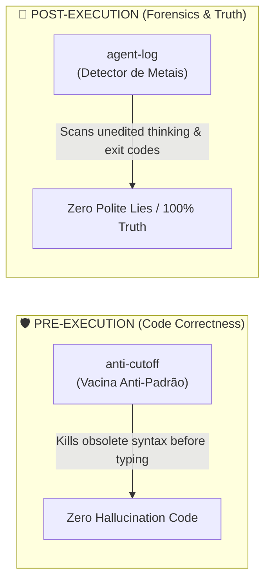

# 🛡️ Anti-Cutoff

> **The Official Vaccine for AI Knowledge Cutoffs (2026 Frontier Edition).**  
> *(Automatically synchronizes live frontier models via OpenRouter, detects post-cutoff library drifts, fetches authoritative `llms.txt` docs, and synthesizes zero-hallucination expert skills).*

[](https://skills.sh)
[](LICENSE)
[](#)
[](#)
[](https://github.com/Gabrielrtads/anti-cutoff/actions)
[](https://github.com/Gabrielrtads/anti-cutoff/stargazers)

```bash
# ⚡ 1-Click Install via skills.sh (Claude Code / Codex / Antigravity):
npx skills add Gabrielrtads/anti-cutoff

# Or check the cutoff gap of any library immediately:
node scripts/anti-cutoff.mjs radar react
```

---

### 🚨 The Problem: "False Confidence" & The Knowledge Cutoff

Every AI model (Claude Sonnet 5.5, GPT-6.1 Sol, Gemini 4 Argon, DeepSeek V4.1) has a fixed **knowledge cutoff date**.
When you ask an AI agent to build with a modern library (e.g., **React 19**, **Next.js 16**, **n8n v2**, **Tailwind v4**, **@modelcontextprotocol/sdk**):

1. The AI model **does not know that it does not know**.
2. It confidently writes code using **deprecated syntax and removed methods** (e.g., using `$getPairedItem` in n8n, legacy cache directives in Next.js, or obsolete MCP endpoints).
3. The build breaks, runtime crashes, and you waste hours debugging outdated hallucinated code.

---

### 💉 The Solution: How `anti-cutoff` Works

`anti-cutoff` turns the model's knowledge cutoff from a point of failure into a **deterministic mathematical trigger**:

```
                       ┌────────────────────────────────────────┐
                       │  Target Library (e.g. n8n or Next.js)  │
                       └───────────────────┬────────────────────┘
                                           │
                        Queries Live Registry API (50ms)
                                           │
                                           ▼
                       ┌─────────────────────────────────────────┐
                       │  Cutoff Drift: Release Date vs Cutoff   │
                       └────────────────────┬────────────────────┘
                                           │
                   ┌────────────────────────┴────────────────────────┐
                   ▼                                                 ▼
        Release <= Model Cutoff                           Release > Model Cutoff
         🟢 Safe Pre-Cutoff                                🚨 Post-Cutoff Drift Detected
         (Normal AI execution)                                       │
                                                    ┌────────────────┴───────────────┐
                                                    ▼                                ▼
                                          Ingests Canonical Docs           Generates Anti-Pattern
                                            (llms.txt / Jina)                Vaccine (Banned APIs)
```

1. **Live Frontier Catalog (`sync-models`):** Automatically pulls real-time model cutoffs from OpenRouter API to track latest frontier releases.
2. **Cutoff Radar:** Compares the package's latest release date against the target model's training cutoff.
3. **Official Ingestion:** Pulls directly from `https://<domain>/llms.txt` or clean Jina markdown readers (bypassing SEO spam and obsolete blog posts).
4. **The Anti-Pattern Vaccine:** Injects an explicit table of banned obsolete patterns vs required modern syntax, suppressing the model's pre-trained priors.

---

## ⚡ Quick Install

### Via `skills.sh` (Recommended for Agents):
```bash
npx skills add Gabrielrtads/anti-cutoff
```

### Global CLI:
```bash
npm install -g anti-cutoff
```

---

## 🛠️ Usage

### 0. Sync Live Frontier Models
Keeps your cutoff radar synced with the latest AI frontier models and dates:
```bash
anti-cutoff sync-models
```

### 1. Check a Package on the Cutoff Radar
```bash
anti-cutoff radar n8n
```
**Output:**
```text
======================================================
🎯 ANTI-CUTOFF RADAR: [n8n]
🤖 Target Model: Standard AI Cutoff Baseline (Cutoff: 2026-09-28)
======================================================
📦 Latest Version : 2.44.5
📅 Release Date   : 2026-10-21
⏳ Cutoff Gap     : +0.8 months (23 days)
🛡️ Risk Status    : 🟡 LOW DRIFT (+0 to 1 month)
📄 Official llms  : ✅ FOUND -> https://docs.n8n.io/llms.txt

💡 VACCINE PRESCRIPTION:
   This package was released AFTER your AI model was trained.
   Relying on built-in AI memory WILL cause breaking change errors.
   Run: anti-cutoff vaccine n8n
```

### 2. Audit an Entire Project (`package.json`)
Run this in any repository to check which installed dependencies exceed your AI model's training knowledge:
```bash
anti-cutoff audit ./my-project
```
Produces an instant risk matrix ranking dependencies by cutoff drift and highlighting packages that require grounding docs.

### 3. Synthesize an Anti-Hallucination Vaccine
```bash
anti-cutoff vaccine <package-name>
```
Generates a structured `SKILL.md` (< 500 lines) with upstream metadata, live docs, and explicit anti-pattern rules.

---

## 🤖 Supported Frontier Models & Live Cutoffs

| Model | Provider | Knowledge Cutoff | Status in Radar |
| :--- | :--- | :---: | :---: |
| **Gemini 4 Argon** | Google | October 2026 | ✅ Live Synced |
| **Claude Sonnet 5.5** | Anthropic | September 2026 | ✅ Live Synced |
| **Claude Opus 5.5** | Anthropic | September 2026 | ✅ Live Synced |
| **Claude Haiku 5.5** | Anthropic | October 2026 | ✅ Live Synced |
| **GPT-6.1 Sol** | OpenAI | September 2026 | ✅ Live Synced |
| **GPT-6 Luna** | OpenAI | September 2026 | ✅ Live Synced |
| **GPT-6 Astra** | OpenAI | September 2026 | ✅ Live Synced |
| **DeepSeek V4.1 Flash** | DeepSeek | September 2026 | ✅ Live Synced |

---

## 🔗 The Agentic Power Duo: `anti-cutoff` + `agent-log`

When building autonomous AI agent systems, these two tools solve the two biggest failure modes of modern LLMs:



- **`anti-cutoff`** protects the agent **BEFORE** it writes code (prevents using dead APIs from outdated training memory).
- **`agent-log`** audits the agent **AFTER** it executes commands (exposes hidden terminal crashes and silent failures without inflating the context window).

---

## 📄 License & Author

MIT License. Designed and built by **Gabriel Toledo ([@Gabrielrtads](https://github.com/Gabrielrtads))**, creator of `vibe-design-studio`, `sta`, `kage-bunshin`, and `agent-log`.

⭐ **If `anti-cutoff` saved you from debugging hallucinated code, star the repo on GitHub!**

---

<div align="center">

### ⭐ Impressed with Anti-Cutoff?
If this tool saved you from outdated hallucinations or breaking changes, please star the repository!  
It helps other autonomous agent developers discover the project.

[](https://github.com/Gabrielrtads/anti-cutoff/stargazers)

---

**Built with pride by [Gabriel Toledo (@Gabrielrtads)](https://github.com/Gabrielrtads)**  
*Creator of [Barber.fi](https://painel.barberfi.com.br), `vibe-design-studio`, `sta`, `kage-bunshin`, and `agent-log`.*

Licensed under [MIT](LICENSE).

</div>
